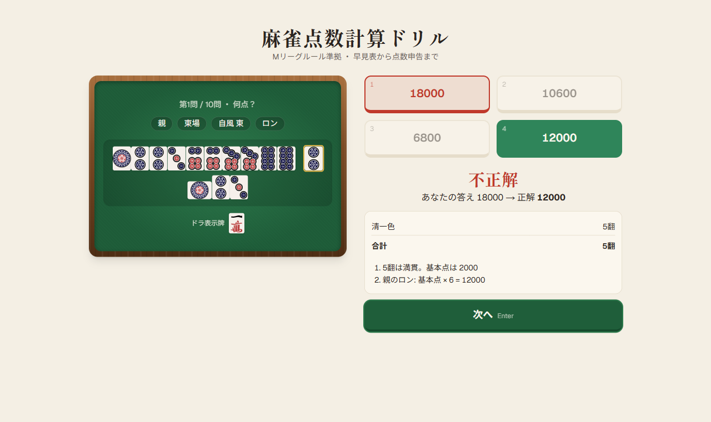

# 麻雀点数計算ドリル（mahjong-drill）

Mリーグルール準拠の、麻雀の点数計算ドリル。早見表の暗記から、手牌を見て点数を申告するところまで、4段階で練習できます。

**https://mahjong-drill-phi.vercel.app**

> `mahjong-drill.vercel.app` は別の人のアプリです。`*.vercel.app` のサブドメインは全ユーザーで共有のため、このプロジェクトには `-phi` 付きのドメインが割り当てられています。



| スマホ（Lv2 符計算）                               | スマホ・ダークモード（Lv3 役を選ぶ）                                  |
| -------------------------------------------------- | --------------------------------------------------------------------- |
|  |  |

## できること

| レベル     | 出題                       | 答えるもの     |
| ---------- | -------------------------- | -------------- |
| Lv1 早見表 | 符・翻・親子・ツモ/ロン    | 点数           |
| Lv2 符計算 | 手牌と和了条件             | 符             |
| Lv3 役・翻 | 手牌と和了条件             | 役の組み合わせ |
| Lv4 総合   | 手牌・和了条件・ドラ表示牌 | 支払う点数     |

- 4択と、自分で答える形式（数値入力・役を選ぶ）を切り替えられる
- 回答後に、符の内訳・役の内訳・点数の計算を手順つきで解説する
- スマホ・タブレット・PC のそれぞれに合わせたレイアウト。PC はキーボード（1〜4 と Enter）でも操作できる
- ダークモードと、OS の「視差効果を減らす」設定に対応

## 工夫したところ

- **正解の根拠は Mリーグ公式ルールの条文**: 役・符・点数・ドラの規則を条文で確かめ、条番号を `docs/requirements.md` の 6 章に残している。条文に書かれていない扱い（ロンで完成した刻子など）は「要確認」として分け、正解がそれに左右される手は出題しない
- **公式の早見表と全マスを照合するテスト**: 早見表（親子 × 11符 × 1〜4翻）をテストの正解データにし、点数計算と「ありえる組み合わせか」の判定を全マスで照合している
- **手牌は自動で作り、正解はエンジンで計算し直す**: 面子から手牌を組み立てたあと、和了形をすべての解釈に分解し直し、最も高い点の解釈を採る（高点法、公式ルール 第6章第5条）。役が偏らないよう、混一色・三色同順などを狙って手を組む
- **テストは 300 件以上**: エンジンのテストは、実装をわざと壊すと落ちることを確かめてから追加している
- **雀卓風のデザイン**: 色は CSS のデザイントークンに集約。アニメーションは問題の切り替え・配牌・正誤の反応・結果の数え上げに絞った

設計の詳細は `docs/features/` に、開発中に学んだことは `docs/lessons_learned.md` にまとめています。

## 技術スタック

- Next.js (App Router) + TypeScript（strict、`noUncheckedIndexedAccess`）
- Tailwind CSS v4、motion（アニメーション）
- Vitest + Testing Library
- ESLint + Prettier、Husky + lint-staged
- GitHub Actions（lint・整形・型・テスト・ビルド）、Vercel

## クレジット

- 牌画像: [FluffyStuff/riichi-mahjong-tiles](https://github.com/FluffyStuff/riichi-mahjong-tiles)（CC0）。`public/tiles/` に同梱
- 見出しのフォント: [Shippori Mincho](https://github.com/fontdasu/ShipporiMincho)（SIL Open Font License 1.1）。OGP 画像用に、使う文字だけを含むものを `src/app/fonts/` に同梱

## セットアップ

```bash
nvm use        # .nvmrc の Node.js に合わせる
npm install
npm run dev    # http://localhost:3000
```

## npm scripts

| コマンド                          | 内容                                 |
| --------------------------------- | ------------------------------------ |
| `npm run dev`                     | 開発サーバー                         |
| `npm run build`                   | 本番ビルド                           |
| `npm run lint`                    | ESLint                               |
| `npm run typecheck`               | 型チェック（`next typegen` → `tsc`） |
| `npm run format` / `format:check` | Prettier で整形 / 整形チェック       |
| `npm test` / `test:run`           | Vitest（watch / 1回実行）            |
